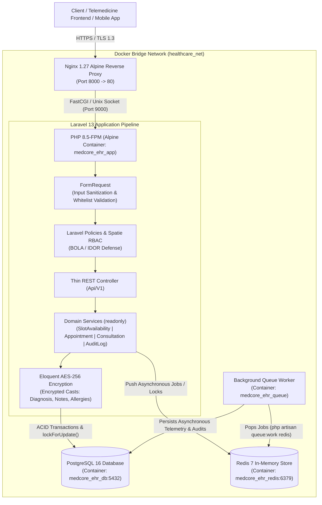
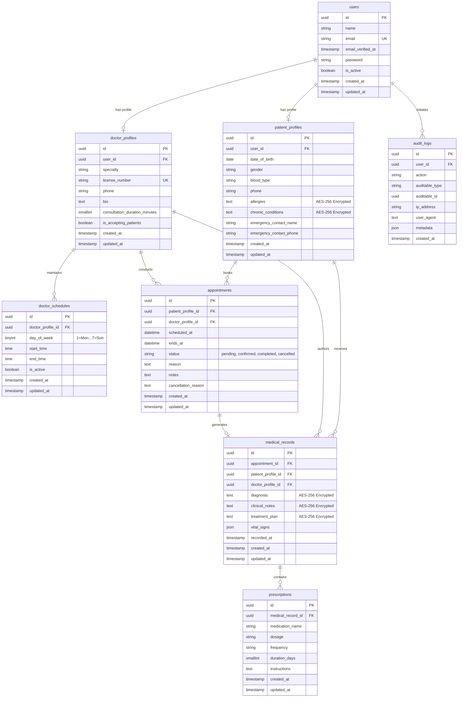

# MedCore EHR & Clinical Appointments API

*Enterprise-Grade, HIPAA-Aligned Healthcare Backend built with Laravel 13, PHP 8.5, PostgreSQL 16, and Redis 7.*

---

<p align="center">
  <a href="https://github.com/gerardorosetti/medcore-ehr-api/actions/workflows/ci.yml"></a>
  <a href="https://www.php.net/releases/8.5/en.php"></a>
  <a href="https://laravel.com/docs/13.x"></a>
  <a href="https://www.postgresql.org/docs/16/index.html"></a>
  <a href="https://redis.io/docs/latest/"></a>
  <a href="./tests"></a>
  <a href="./routes/api.php"></a>
  <a href="./SECURITY.md"></a>
  <a href="./LICENSE"></a>
</p>

---

## 1. Executive Overview & Domain Context

The **MedCore EHR & Clinical Appointments API** is a high-availability, mission-critical healthcare backend engineered specifically for modern telemedicine networks, multi-specialty clinical practices, and hospital outpatient operations. 

Healthcare systems operate under unforgiving operational and regulatory realities:
- **Zero-Tolerance Concurrency Risks**: An appointment scheduling system cannot tolerate race-condition double-bookings. Simultaneous patient requests for the same physician slot must be handled with strict pessimistic database isolation, eliminating conflicting clinical reservations.
- **Strict Protected Health Information (ePHI) Confidentiality**: Under **HIPAA § 164.312(a)(2)(iv)**, patient diagnoses, consultation notes, allergies, and chronic conditions must never exist in plain text at rest.
- **Immunity Against Broken Object Level Authorization (BOLA / IDOR)**: Clinical endpoints must enforce object-level authorization policies ensuring that treating physicians, authorized clinical personnel, and patients only ever access records explicitly permitted within their care relationship.
- **Regulatory Audit Trail & Accountability**: Under **HIPAA § 164.312(b)**, every mutation, creation, and inspection of electronic health records must produce an immutable, append-only compliance log capturing user context, network telemetry, and timestamps.
- **Asynchronous Clinical Event Orchestration**: Background worker queues running on Redis decouple high-throughput clinical workflows—such as notification dispatching, external laboratory synchronization, and prescription reporting—from HTTP request-response lifecycles.

MedCore represents an enterprise-grade standard for healthcare software engineering, fusing **PHP 8.5** and **Laravel 13** with hardened container infrastructure, robust domain modeling, and comprehensive security postures.

---

## 2. System Design & Architectural Patterns

### Clean Layered Architecture (Service Layer Pattern)

MedCore strictly adheres to **Separation of Concerns (SoC)** and **Single Responsibility Principle (SRP)**. Controllers contain zero raw database queries, zero inline validation arrays, and zero unencapsulated business logic.

```
Incoming Request
      │
      ▼
┌────────────────────────────────────────────────────────┐
│ Thin REST Controller (app/Http/Controllers/Api/V1/)    │
│  - Accepts typed FormRequest                           │
│  - Authorizes via Laravel Policy                       │
│  - Delegates domain logic to injected readonly Service │
│  - Returns formatted JsonResource                      │
└─────────────────────────┬──────────────────────────────┘
                          │
                          ▼
┌────────────────────────────────────────────────────────┐
│ Domain Service Layer (app/Services/)                   │
│  - SlotAvailabilityService                             │
│  - AppointmentService (DB::transaction + lockForUpdate)│
│  - MedicalConsultationService                          │
│  - AuditLogService                                     │
└─────────────────────────┬──────────────────────────────┘
                          │
                          ▼
┌────────────────────────────────────────────────────────┐
│ Data Layer & Persistence                               │
│  - Eloquent Models with HasUuids                       │
│  - Native Encrypted PHI Casts (AES-256)                │
│  - PostgreSQL 16 & Redis 7 Background Queues           │
└────────────────────────────────────────────────────────┘
```

#### 1. Thin REST Controllers (`app/Http/Controllers/Api/V1/`)
- HTTP controllers are lightweight orchestrators. They receive strongly typed, pre-validated inputs via dedicated `FormRequest` classes, authorize the action against granular `Policy` checks, invoke pure domain services, and transform internal models using `JsonResource` serialization.

#### 2. Domain Service Layer (`app/Services/`)
- **`SlotAvailabilityService`**: Algorithmic engine that dynamically computes free consultation windows for a given physician on any requested calendar date. It cross-references weekly recurring `DoctorSchedule` availability blocks against active (`pending` / `confirmed`) `Appointment` records, factoring in physician-specific appointment durations (e.g., 30-minute intervals).
- **`AppointmentService`**: Manages transactional appointment reservation and cancellation. To guarantee zero double-booking under extreme concurrency, it opens an explicit `DB::transaction` and applies PostgreSQL pessimistic row-level locking (`->lockForUpdate()`) over both the target `DoctorProfile` and overlapping appointment intervals.
- **`MedicalConsultationService`**: Executes the atomic conclusion of a clinical consultation. In a single ACID transaction, it validates state-machine transitions (e.g., `confirmed` $\rightarrow$ `completed`), persists the encrypted `MedicalRecord`, stores multiple `Prescription` line items, updates the parent `Appointment`, and emits an immutable compliance audit record.
- **`AuditLogService`**: Centralized service responsible for recording append-only audit events required by HIPAA § 164.312(b). Logs capture actor identity (`user_id`), normalized event names (e.g., `medical_record.viewed_phi`, `appointment.scheduled`), target morph IDs, client IP addresses, user agents, and structured metadata.

---

### Modern PHP 8.5 Capabilities

MedCore leverages the bleeding edge of the PHP language runtime to ensure maximum type safety, immutability, and expressive functional data transformations:

```php
declare(strict_types=1);

namespace App\Services;

/**
 * Modern PHP 8.5 immutable domain service.
 */
readonly class AppointmentService
{
    /**
     * Functional clinical text sanitization pipeline using the PHP 8.5 Pipe Operator (|>)
     */
    private function sanitizeClinicalText(string $input): string
    {
        return $input
            |> trim(...)
            |> strip_tags(...)
            |> (fn (string $text): string => preg_replace('/\s+/', ' ', $text) ?? $text);
    }

    /**
     * State transition method guarded by the #[\NoDiscard] attribute.
     */
    #[\NoDiscard]
    public function schedule(
        PatientProfile $patient,
        DoctorProfile $doctor,
        CarbonInterface $scheduledAt,
        string $reason,
        ?string $notes = null
    ): Appointment {
        // Atomic pessimistic transaction...
    }
}
```

1. **Native Pipe Operator (`|>`)**: Applied in clinical data sanitization pipelines (`$input |> trim(...) |> strip_tags(...) |> ...`) for readable, deterministic, functional text transformations without nested procedural wrappers.
2. **`#[\NoDiscard]` Attribute**: Annotated on critical state-machine transitions and domain service methods. Any caller ignoring the return value of an appointment transition or record compilation triggers a compile/analyzer alert, preventing dropped domain states.
3. **Strict Types & Readonly Service Classes**: 100% of files enforce `declare(strict_types=1);`. All domain services are declared `readonly`, enforcing complete immutability and thread safety across container execution lifecycles.

---

### Granular Rate Limiting & Sanctum Token Ability Scopes

To safeguard healthcare infrastructure against brute-force credential stuffing, API resource exhaustion, and unauthorized clinical privilege escalation, MedCore deploys multi-tiered rate limiting and scoped token authorization:

#### 1. Granular Rate Limiters (`app/Providers/AppServiceProvider.php`)
- **`throttle:auth` (5 requests / min)**: Keyed on `ip | email` to block distributed brute-force attacks against authentication endpoints (`/api/v1/auth/login`, `/api/v1/auth/register`).
- **`throttle:appointments` (15 requests / min)**: Keyed on authenticated `user_id` (or fallback client IP). Restricts high-frequency booking and cancellation requests to protect pessimistic lock transactions from denial-of-service degradation.
- **`throttle:api` (60 requests / min)**: Applied globally to the `/api/v1/*` routing pipeline, establishing an upper resource consumption bound per user or client IP.

#### 2. Laravel Sanctum Scoped Token Abilities (`bootstrap/app.php`)
Sanctum token abilities are registered via middleware aliases (`ability` $\rightarrow$ `CheckForAnyAbility`, `abilities` $\rightarrow$ `CheckAbilities`) to enforce least-privilege token access:
- **`ability:appointments:read`**: Required to inspect appointment schedules and historical bookings.
- **`ability:appointments:write`**: Required to create new reservations or execute clinical cancellations.
- **`ability:medical-records:read`**: Required to inspect encrypted patient medical records.
- **`ability:medical-records:write,prescriptions:write`**: Required to compile medical consultations, encrypt diagnoses, and issue medication prescriptions.

---

### Cybersecurity & HIPAA Hardening *(See [SECURITY.md](SECURITY.md))*

Healthcare applications demand an aggressive **Defense-in-Depth** security architecture. MedCore Health Systems implements defenses across application, database, and container boundaries:

- **AES-256 Protected Health Information (ePHI) Encryption at Rest**:
  Medical histories, patient allergies, diagnoses, clinical notes, and treatment plans are encrypted using AES-256 via Eloquent's native `encrypted` and `encrypted:array` attribute casts:
  ```php
  class MedicalRecord extends Model
  {
      use HasUuids;

      protected $casts = [
          'diagnosis'      => 'encrypted',
          'clinical_notes' => 'encrypted',
          'treatment_plan' => 'encrypted',
          'vital_signs'    => 'array',
          'recorded_at'    => 'datetime',
      ];
  }
  ```
  Database dumps, backups, or raw SQL queries reveal zero plain-text medical records, neutralizing database-at-rest exfiltration risks.

- **Non-Enumerable UUID Primary Keys & BOLA/IDOR Prevention**:
  All primary and foreign keys utilize cryptographically random UUIDs (`HasUuids`), thwarting enumeration attacks. Object access is governed by dedicated Laravel Policies (`AppointmentPolicy`, `MedicalRecordPolicy`) coupled with `spatie/laravel-permission` role checks (`admin`, `doctor`, `patient`) and Laravel Sanctum v4 scoped bearer tokens.

- **Dynamic Sort Column Allowlisting (SQL Injection Defense)**:
  User-supplied query parameters for sorting and filtering (`sort_by`, `order`) are validated against strict whitelist enums (`Rule::in(Appointment::ALLOWED_SORT_COLUMNS)`) before reaching Eloquent builders, blocking dynamic SQL identifier injection.

- **Runtime CVE Mitigations (2024–2026)**:
  Hardened container configurations (`docker/php/99-hardened.ini`, `docker/php/zz-docker.conf`, `docker/nginx/default.conf`) provide defense against critical modern PHP ecosystem vulnerabilities:
  - **`CVE-2026-109618` & `CVE-2026-109619` ("php2shell")**: Multipart boundary parsing memory corruption mitigated via Alpine-pinned PHP 8.5 runtime, strict Nginx upload constraints (`client_max_body_size 12M;`), PHP memory limits (`post_max_size = 12M`, `upload_max_filesize = 10M`), and automatic PHP-FPM process recycling (`pm.max_requests = 500`).
  - **`CVE-2024-52301`**: Exploitation of `register_argc_argv` query parameter pollution neutralized via `register_argc_argv = Off` and Laravel 13 web SAPI argument isolation.
  - **`CVE-2024-4577`**: FastCGI path traversal and command injection prevented via `cgi.fix_pathinfo = 0` and strict FastCGI extension binding `security.limit_extensions = .php`.

---

## 3. System Architecture & Entity-Relationship Diagrams

### Docker & Request / Queue Pipeline Flowchart



---

### Clinical Database Entity-Relationship Diagram (ERD)



---

## 4. Quickstart (2 Commands with Docker Compose — Zero Host Dependencies)

The MedCore repository is fully containerized. You do not need PHP, Composer, PostgreSQL, or Redis installed on your local host machine. Only **Docker** and **Docker Compose** are required.

### Step 1: Clone & Start Containers
```bash
docker compose up -d --build
```
This builds and boots all 5 isolated micro-services:
1. `medcore_ehr_app` (PHP 8.5-FPM + Composer)
2. `medcore_ehr_nginx` (Hardened Nginx 1.27 Web Server on `localhost:8000`)
3. `medcore_ehr_db` (PostgreSQL 16 on `localhost:54320`)
4. `medcore_ehr_redis` (Redis 7 In-Memory Engine on `localhost:63790`)
5. `medcore_ehr_queue` (Asynchronous Redis Queue Worker)

### Step 2: Run UUID Migrations & Clinical Showcase Seeder
```bash
docker compose exec app php artisan migrate:fresh --seed
```
This prepares the PostgreSQL schema (`medcore_ehr`) with UUID primary keys and populates an idempotent clinical dataset complete with administrative users, board-certified physicians, recurring weekly schedules, patients with encrypted allergies and conditions, historical appointments, encrypted medical records, prescriptions, and HIPAA audit trails.

---

### Access & Operational Portals

| Interface / Endpoint | URL | Description |
| :--- | :--- | :--- |
| **Clinical Command Console** | [http://localhost:8000](http://localhost:8000) | Live architecture dashboard, database/cache telemetry, and one-click demo token generator |
| **Interactive OpenAPI 3.1 Portal** | [http://localhost:8000/docs/api](http://localhost:8000/docs/api) | Real-time Swagger / Scramble interactive API documentation with dynamic schema inspection |
| **OpenAPI 3.1 JSON Specification** | [http://localhost:8000/docs/api.json](http://localhost:8000/docs/api.json) | Machine-readable OpenAPI 3.1 contract for Postman / Insomnia import and SDK generation |
| **Health Telemetry Endpoint** | [http://localhost:8000/api/v1/health](http://localhost:8000/api/v1/health) | High-frequency JSON healthcheck probe reporting PostgreSQL & Redis connectivity states |

---

### Pre-Seeded Clinical Demo Credentials

Every pre-seeded account is protected with the shared demonstration password:  
**`Password123!`**

| Name | Role | Email | Clinical Specialization / Context |
| :--- | :--- | :--- | :--- |
| **System Administrator** | `admin` | `admin@medcore.com` | Global platform administration, unconstrained HIPAA audit log inspection |
| **Dr. Gregory House** | `doctor` | `dr.house@medcore.com` | Diagnostic Medicine (Board Certified Nephrology & Infectious Disease) &bull; Mon–Fri 09:00–17:00 |
| **Dr. Lisa Cuddy** | `doctor` | `dr.cuddy@medcore.com` | Dean of Medicine & Endocrinology Services &bull; Mon–Fri 08:00–16:00 |
| **Ana Martinez** | `patient` | `patient.ana@medcore.com` | Patient profile with encrypted ePHI: Blood Type O+, Allergies (Penicillin, Latex), Asthma |
| **Carlos Mendoza** | `patient` | `patient.carlos@medcore.com` | Patient profile with encrypted ePHI: Blood Type A+, Allergies (Sulfa drugs), Hypertension |

---

## 5. API v1 Endpoints Reference Table

All clinical endpoints are versioned under `/api/v1/*`. Authenticated endpoints require a standard HTTP Authorization header:  
`Authorization: Bearer <sanctum_token>`

| HTTP Verb | Endpoint URI | Auth / Rate Limit / Ability Scope | Description |
| :--- | :--- | :--- | :--- |
| `POST` | `/api/v1/auth/register` | Public &bull; `throttle:auth` (5/min) | Register a new patient user and automatically initialize their `PatientProfile`. |
| `POST` | `/api/v1/auth/login` | Public &bull; `throttle:auth` (5/min) | Validate email/password credentials and return a scoped Sanctum Bearer token. |
| `GET` | `/api/v1/auth/me` | `auth:sanctum` &bull; `throttle:api` (60/min) | Retrieve authenticated user details, clinical profile data, and assigned Spatie roles. |
| `POST` | `/api/v1/auth/logout` | `auth:sanctum` &bull; `throttle:api` (60/min) | Revoke and purge the current active Sanctum access token. |
| `GET` | `/api/v1/doctors` | Public &bull; `throttle:api` (60/min) | Search and list active physicians with specialty filtering and sort allowlists. |
| `GET` | `/api/v1/doctors/{doctor}` | Public &bull; `throttle:api` (60/min) | Retrieve detailed physician profile including recurring weekly schedule blocks. |
| `GET` | `/api/v1/doctors/{doctor}/available-slots` | Public &bull; `throttle:api` (60/min) | Calculate real-time free consultation slots for a doctor on a target `?date=YYYY-MM-DD`. |
| `PUT` | `/api/v1/doctors/{doctor}/schedules` | `auth:sanctum` (`doctor`, `admin`) &bull; `throttle:api` | Create or replace weekly consultation schedule intervals for a physician profile. |
| `GET` | `/api/v1/appointments` | `auth:sanctum` &bull; `ability:appointments:read` | List appointments automatically scoped by role (patients view theirs, doctors view their clinical queue). |
| `POST` | `/api/v1/appointments` | `auth:sanctum` (`patient`, `admin`) &bull; `throttle:appointments` (15/min) &bull; `ability:appointments:write` | Book a consultation slot using pessimistic locking (`lockForUpdate`) to prevent double-booking. |
| `GET` | `/api/v1/appointments/{appointment}` | `auth:sanctum` &bull; `ability:appointments:read` &bull; Policy Protected | Inspect a single appointment (enforces ownership or doctor-patient care relationship). |
| `PATCH` | `/api/v1/appointments/{appointment}/cancel` | `auth:sanctum` &bull; `throttle:appointments` (15/min) &bull; `ability:appointments:write` &bull; Policy Protected | Transition an appointment to `cancelled` state with required clinical reason. |
| `POST` | `/api/v1/appointments/{appointment}/medical-record` | `auth:sanctum` (Treating `doctor`) &bull; `ability:medical-records:write,prescriptions:write` | Complete consultation: atomically author encrypted `MedicalRecord` and `Prescriptions`. |
| `GET` | `/api/v1/medical-records` | `auth:sanctum` &bull; `ability:medical-records:read` &bull; Policy Protected | List electronic health records scoped to the patient, treating doctor, or administrator. |
| `GET` | `/api/v1/medical-records/{medicalRecord}` | `auth:sanctum` &bull; `ability:medical-records:read` &bull; Policy Protected | Decrypt and retrieve full clinical EHR record; automatically writes a HIPAA audit log. |
| `GET` | `/api/v1/audit-logs` | `auth:sanctum` (`admin` only) &bull; `throttle:api` | Query append-only HIPAA § 164.312(b) audit trail with action and date range filters. |
| `GET` | `/api/v1/health` | Public (Unauthenticated) | Telemetry endpoint returning PostgreSQL and Redis connection health states. |

---

## 6. Cross-Stack Architecture Mapping (Django / DRF $\leftrightarrow$ Laravel 13)

For engineers working across Python and PHP ecosystems, the following table maps how architectural patterns in **Python (Django REST Framework)** translate directly into this **PHP 8.5 / Laravel 13** implementation:

| Architectural Component | Django REST Framework (DRF) | MedCore EHR API (Laravel 13) | Engineering Rationale & Implementation |
| :--- | :--- | :--- | :--- |
| **Schema & Data Modeling** | `models.Model` + `makemigrations` | Eloquent Models (`HasUuids`) + Migrations | Expressive schema management with strictly typed database migrations, foreign key cascades, and UUID primary keys. |
| **Request Validation** | `serializers.Serializer` / `clean()` | Dedicated `FormRequest` Classes | Isolates HTTP input validation from controller logic. Automatically sanitizes strings and enforces sort column whitelists before hitting business logic. |
| **Response Serialization** | `serializers.ModelSerializer` | Dedicated `JsonResource` Transformers | Decouples internal database schemas from external API representation. Prevents accidental exposure of raw database columns. |
| **Object-Level Authorization** | `permissions.BasePermission` (`has_object_permission`) | Laravel `Policies` (`AppointmentPolicy`, `MedicalRecordPolicy`) | Guarantees immunity against Broken Object Level Authorization (BOLA/IDOR). Verifies ownership and doctor-patient treatment relationships. |
| **Role-Based Access Control** | `django.contrib.auth` / `django-guardian` | `spatie/laravel-permission` (Guard `web`) | Multi-tier RBAC (`admin`, `doctor`, `patient`) cached in Redis for sub-millisecond route-level authorization gates. |
| **Asynchronous Task Processing** | Celery + Redis Broker | Laravel Queues (`ShouldQueue`) + Redis | Asynchronous background execution of clinical notifications, external lab webhooks, and intensive reports via dedicated worker containers. |
| **API Contract & Documentation** | `drf-spectacular` (OpenAPI 3) | `dedoc/scramble` (OpenAPI 3.1) | Dynamic, zero-annotation OpenAPI 3.1 contract generation derived automatically from route declarations, FormRequests, and Eloquent types. |
| **Automated Testing Suite** | `pytest` / `pytest-django` | `pestphp/pest` (Pest v5) + `pest-plugin-laravel` | Modern, highly expressive functional and behavioral testing framework with integrated database refreshes and role factories. |
| **Concurrency & Lock Control** | `select_for_update()` inside `transaction.atomic()` | `lockForUpdate()` inside `DB::transaction()` | Pessimistic row locking on physician schedules and appointments to prevent race conditions during high-volume booking. |
| **Field-Level Data Encryption** | `django-cryptography` / `pgcrypto` | Eloquent `encrypted` & `encrypted:array` Casts | Native AES-256 symmetric encryption of ePHI fields at rest, decrypted transparently only when hydrated into authorized models. |

---

## 7. Engineering Governance, GitFlow Workflow & Quality Assurance

### Strict GitFlow Branching Model

To guarantee stability, auditability, and seamless clinical deployments, MedCore adheres strictly to the **GitFlow** branching methodology:

```
[ main ]  ─────────────────────────● (Tagged Production Release v1.0.0)
                                  ▲
                                  │ (Merge via PR with --no-ff)
[ development ] ──●───────────────●─────────────────────────────────────
                   ▲             ▲
      Branch from  │             │ Merge via --no-ff
                   │             │
[ feature/* ] ─────┴──●──●───────┘ (feat: atomic domain capability)
[ chore/* ]   ────────●──────────┘ (chore: dependency / pipeline update)
[ test/* ]    ────────●──────────┘ (test: pest feature test coverage)
[ docs/* ]    ────────●──────────┘ (docs: architecture documentation)
```

1. **`main`**: Represents production-ready code. Commits are never pushed directly to `main`. Every release is tagged with semantic versioning (e.g., `v1.0.0`).
2. **`development`**: Serves as the primary integration branch for finished features, fixes, and architectural enhancements.
3. **Topic Branches (`feature/*`, `chore/*`, `test/*`, `docs/*`)**: All development takes place in isolated branches branched off `development`.
4. **Conventional Commits**: Every commit adheres to the Conventional Commits specification:
   - `feat(scheduling): implement pessimistic slot locking in AppointmentService`
   - `fix(security): sanitize clinical notes against script injection`
   - `test(ehr): add unit test coverage for encrypted medical record casts`
   - `docs(readme): add system architecture diagrams and DRF mapping`
5. **Merge Policy**: All branches are integrated into `development` and `main` using explicit non-fast-forward merges (`git merge --no-ff`) to preserve branch history and audit context.

---

### Automated Quality Gates

Every pull request and release candidate must pass all automated quality gates executed inside the isolated PHP 8.5 container:

#### 1. Pest v5 Test Suite Execution
Execute the entire unit and feature test suite with colored output:
```bash
docker compose exec app ./vendor/bin/pest
```

#### 2. Laravel Pint Code Style & PSR-12 Linting
Verify strict adherence to Laravel and PSR-12 coding standards:
```bash
docker compose exec app ./vendor/bin/pint --test
```

#### 3. Composer Supply-Chain Security Audit
Audit all third-party PHP dependencies against the public vulnerability database:
```bash
docker compose exec app composer audit
```

---

## 8. License & Intellectual Property

This project is open-source software licensed under the **[MIT License](LICENSE)**.

Developed with precision for **MedCore Health Systems** &bull; Advancing secure, resilient, and human-centric digital health infrastructure.
